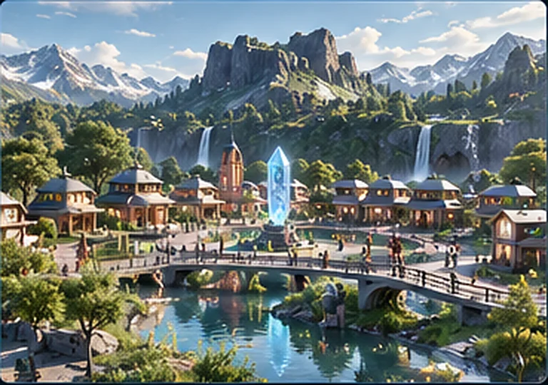
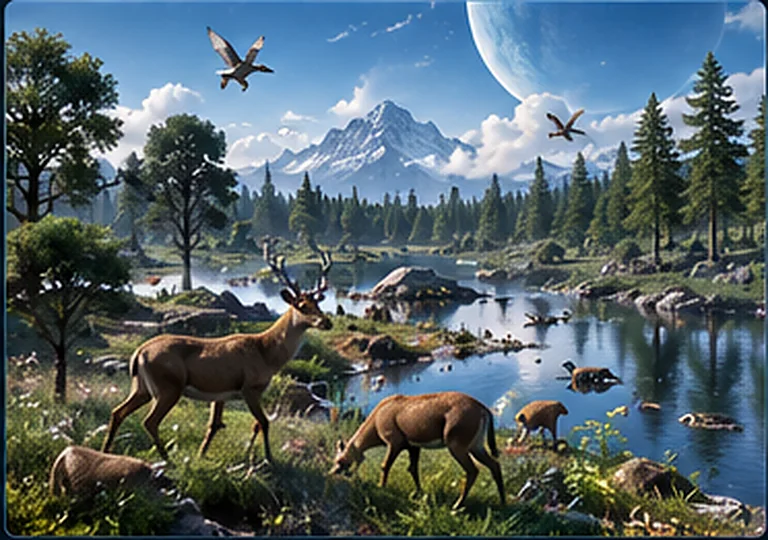
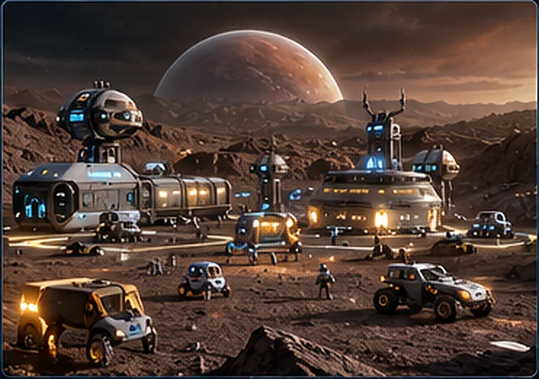
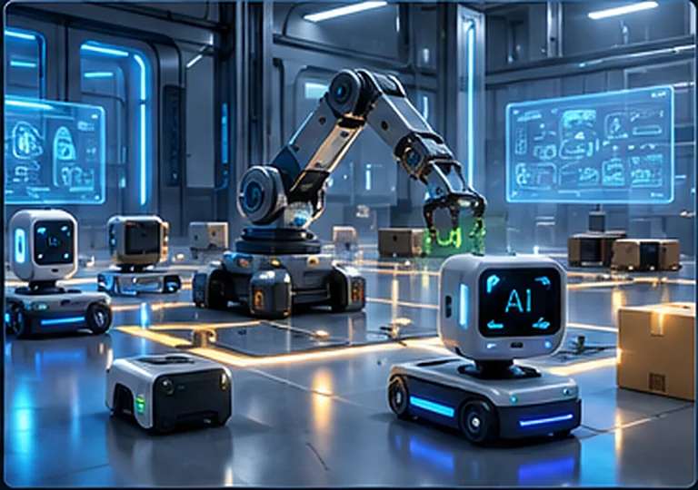

# Layer 1+ — Neural Artificial Life Sandbox

[](https://github.com/Janus5G/layer1-neural-world/releases/tag/v1.2.0)
[](https://github.com/Janus5G/layer1-neural-world/actions/workflows/engine-bridge-tests.yml)
[](https://github.com/Janus5G/layer1-neural-world/actions/workflows/cuda-mcp-ci.yml)
[](LICENSE)
[](docs/RELEASE_V1.2.0.md)
[](docs/CUDA_MCP_INTEGRATION.md)
[](integrations/roboforge/README.md)
[](https://www.typescriptlang.org/)
[](https://nodejs.org/)
[](docs/ENGINE_BRIDGE.md)

A small **experimental artificial-life simulation** with embodied neural agents in a browser-based world. Agents use hand-written neural networks to select actions, receive rewards, move around, interact, reproduce, and explore. An **optional local Ollama model** generates short agent narratives and ideas.

**v1.2.0:** Optional Linux-only PyTorch/CUDA neural inference and training, plus a **local read-only MCP** adapter for future RoboForge integration. The CUDA backend completed a 20-minute RTX 5050 test (64 °C maximum observed GPU temperature), but CPU temperature and a speedup over the CPU reference were not verified. See the [release evidence](docs/RELEASE_V1.2.0.md).

**Status:** This repository contains the original experimental **Layer 1 / 1+ source**, translated into English. It is released **as-is**. The author does **not** plan additional levels or ongoing feature development; community forks are welcome. Later layers in [the roadmap](docs/ROADMAP.md) are historical ideas, **not built features**.

This is **not evidence of artificial consciousness or validated self-recognition**, and is not a production-grade or peer-reviewed system. The modeled pleasure, affect, curiosity, and mirror-mark behavior are simulation constructs. See [Ethics](docs/ETHICS.md).

## A simple world. Many possible worlds.

Layer 1+ is a **working experimental neural-agent simulation**, not a finished game engine. Its simple square markers keep the original visualization lightweight while the code explores neural policies, reward-driven learning, interaction, curiosity, and inheritance. The visual appearance can be changed independently by adapting the Canvas viewer; new gameplay, simulation rules, and communication mechanisms require additional implementation.

### Inspiration for developers

The following are **original, high-detail concept illustrations** showing what developers *might* build from the experimental foundation. **They are not screenshots, current features, or evidence that these scenarios have been implemented.** None of this artwork is part of the running viewer.

| Living village | Ecosystem simulation |
|:---:|:---:|
|  |  |
| Develop inhabitants with needs, relationships, resource use, and local interactions. | Extend the environment with species, habitats, competition, and changing resources. |

| Colony simulation | Robot world |
|:---:|:---:|
|  |  |
| Explore collective behavior, specialization, and coordination in a settlement or colony. | Adapt sensors and actions for simulated robots and tasks in more complex environments. |

### Possible extensions

- **Visuals:** Replace square markers with detailed sprites, animations, or other renderers without mistaking graphic fidelity for intelligence.
- **New worlds:** Build village, ecosystem, colony, or robot simulations by extending sensors, actions, rewards, physics, and world rules.
- **Research and education:** Visualize neural learning, population dynamics, exploration, and behavior while measuring results rather than assuming emergent intelligence.
- **Communication experiments:** A future derivative might test agent-to-agent or AI-to-AI communication inside a controlled simulation, but no such integration with an external neural network is implemented or claimed here.

The code is released as a small **foundation to explore and extend**, not as a claim that any of the illustrated scenarios are already achievable without additional work. The original author does not plan further levels; independent development and forks are welcome under the [MIT license](LICENSE).

## Unity and Godot Engine Bridge (optional)

The project now includes an **experimental local neural-action bridge** that game developers can use without running the original artificial-life world. Unity or Godot owns its own scene, physics, objects, sensors and rewards; the standalone TypeScript server provides a per-agent neural policy through a loopback-only WebSocket connection. **This is a developer interface, not a validated AI or a completed game engine.**

```sh
npm ci
npm run bridge
```

Connect your desktop game to `ws://127.0.0.1:9090/engine/ws`. The feature is off by default in the normal `npm start` mode, uses no Ollama, and starts with untrained random neural weights. Low-load examples default to learning disabled. See the [Engine Bridge protocol and limitations](docs/ENGINE_BRIDGE.md), [Unity example](examples/unity/README.md), and [Godot 4 example](examples/godot/README.md). Neither game-engine example has been verified inside its native editor.

## Quick start

**Hardware and temperature note:** Per-agent neural training can sustain substantial CPU load. An optional local Ollama model may add heavy processing when GPU acceleration is unavailable. On thermally constrained computers, lower the simulation workload, monitor temperatures, and stop if the system becomes excessively hot. You do not need Ollama to run the basic simulation.

**Requirements:** Node.js 20+ and npm. Optional: Ollama and a local compatible model for generated agent text.

From the repository directory:

```bash
npm ci
npm run typecheck
npm start
```

Open **http://localhost:8787** in your browser. `npm run dev` starts the TypeScript process in watch mode.

`npm ci` restores packages from `package-lock.json`. **`node_modules` is deliberately not included** in this source release. Internet access may be required for the initial npm dependency installation. The basic simulation does not require an external AI API or Ollama.

### Optional local language model

Install [Ollama](https://ollama.com/) and download a model that is actually available in your installation, for example:

```bash
ollama pull qwen3:4b-instruct
```

If Ollama is not already running, start its service according to your operating system (often `ollama serve`). In the browser sidebar, enter the Ollama host (`http://127.0.0.1:11434`), model name, enable the checkbox, and click **Save**. The prompt asks Ollama to respond in English (a particular model may not always comply). The local LLM is used only for language generation; the agent policy and reward-based training run separately. No Ollama account or cloud API key is needed.

If your model name differs, enter its installed identifier. The example tag above is not guaranteed to exist for every Ollama installation. Performance depends on hardware and model size.

## Optional Linux CUDA and local MCP (v1.2.0)

This release-candidate branch adds an **optional**, Linux-only PyTorch CUDA
neural worker. In CUDA mode, neural forward passes and training are offloaded
to PyTorch on the NVIDIA GPU. Sensors, physics and action sampling still run
on CPU. The original CPU simulation remains available unchanged.

GPU mode observes a pre-action world snapshot for each tick instead of the
reference implementation's sequential sensing, so agent outcomes may differ.
**CUDA execution was verified on an RTX 5050 with a 20-minute run (maximum observed GPU 64 °C); CPU temperatures, 1× simulation speed and parity remain unverified.**

Inspect your NVIDIA GPU and the driver-supported CUDA version before any
changes:

```sh
python3 scripts/setup_gpu.py
```

To consent to installing a compatible CUDA-enabled PyTorch build inside this
repository's private `.venv` (no system-driver installation), run:

```sh
python3 scripts/setup_gpu.py --install
npm ci
npm run start:cuda
```

If a supported GPU or wheel cannot be verified, installation stops rather
than silently switching back to high-load CPU training. To run the unchanged
CPU reference path, use `npm start`. The hardware checker and CUDA worker
are independent of optional Ollama inference.

A separate local-only, read-only MCP stdio adapter is available with
`npm run mcp:stdio`. It exposes only `layer1_status_v1` and
`layer1_brain_trace_v1`; it cannot mutate or start a simulation. This is an
**integration candidate**, not an already registered RoboForge tool or an
authorized ChromaNeural capability. Registration in RoboForge, the existing
managed-grant model and DeepSeek Janus image-generation integration remain
separate acceptance steps.

See [v1.2.0 release evidence](docs/RELEASE_V1.2.0.md) and [CUDA and MCP integration guide](docs/CUDA_MCP_INTEGRATION.md) for
architecture, safety limits, verification status and Linux setup.

## What's in Level 1+

- Small neural network per agent: 40 inputs, two hidden layers of 48 neurons, 11 actions, and policy/value heads.
- Hand-written `Float32Array` math, Adam optimizer, Advantage Actor-Critic-style updates, and generalized advantage estimation.
- Toroidal 2D simulation with food, hazard zones, mirrors, age, energy, integrity, and simulated affect.
- Reproduction with genome crossover and inheritance/mutation of learned neural weights.
- Curiosity-like novelty scores and generated exploration ideas.
- A reward-shaped **simulated mirror-mark task**; task completion is not evidence of consciousness or real animal-style mirror self-recognition.
- Canvas 2D viewer, agent details, brain-activity trace, events, and Ollama configuration.

Agents begin with random neural weights; outcomes, learning rates, and survival times are **not guaranteed**. There are no experimental controls, published replication data, or scientific performance claims included here.

## Project layout

```text
layer1-neural-world/
├── src/
│   ├── index.ts                 # Local HTTP/WebSocket server, loops, controls
│   ├── cognition/ollama.ts      # Optional local language generation
│   ├── neural/network.ts       # Neural network and learning code
│   └── world/                  # Agent, senses, world, action definitions
├── public/
│   ├── index.html               # Browser viewer
│   ├── viewer.js                # Browser rendering and controls
│   └── style.css
├── docs/                        # English architecture, ethics, ideas
├── tests/                       # Minimal release regression checks
├── package.json
├── package-lock.json
├── tsconfig.json
├── LICENSE
└── .gitignore
```

## Testing

```bash
npm run typecheck
npm test
```

The tests check basic neural/simulation contracts, English localization, and key configuration values; they are **not** a scientific benchmark. The Ollama-language-generation pathway needs a separately running Ollama model and is not covered by offline test assertions.

## Usage and security notes

- Intended for **local experimentation**, not public deployment. The original server does not provide authentication for administrative and control endpoints. Do not expose port `8787` to untrusted users or the Internet; use a restricted local environment. The Ollama host setting is configurable, so keep it limited to trusted local endpoints.
- Pause and Reset are available in the viewer. An in-memory maximum-runtime check is configured for 90 minutes by default.
- There is **no implemented persistent world save/load** in this release: restarting the server resets agents. The project is provided without maintenance guarantees.
- Agent utterances are generated text; do not interpret them as direct evidence of mental experiences.

## Read more

- [Architecture](docs/ARCHITECTURE.md)
- [Ethics](docs/ETHICS.md)
- [Original roadmap / future ideas](docs/ROADMAP.md)
- [Future Development Guide (PDF)](docs/Layer1-Neural-World-Future-Development-Guide.pdf) - Proposed Village, Nature, Colony and Robot extensions plus game-engine bridges; not implemented.
- [Guide for independent contributors](docs/EXTENDING.md)
- [GitHub publishing guide](docs/PUBLISHING.md)
- [Validation results and limits](docs/VALIDATION.md)

## Contributors and acknowledgements

**Original project creator, copyright holder, and maintainer:** [Janus Rokkjær (Janus5G)](https://github.com/Janus5G).

**AI-assisted contributor — ChatGPT (OpenAI):** assisted with English-language documentation, the developer-facing README and examples, the optional Unity/Godot Engine Bridge, and related regression tests. These are acknowledged as AI-assisted contributions, not as authorship of the original artificial-life experiment. GitHub's contributors graph reflects commit author identities and does not automatically list ChatGPT as a separate GitHub user.

**Additional assistance:** GitHub Copilot proposed a fix for the Engine Bridge WebSocket error-handling review finding.

All project maintenance and publication decisions remain with the repository owner. These acknowledgements do not imply endorsement, certification, or independent validation by OpenAI or GitHub.

## License

[MIT](LICENSE). Copyright © 2026 Janus Rokkjær. The dependency packages are installed separately through npm and retain their own licenses.
