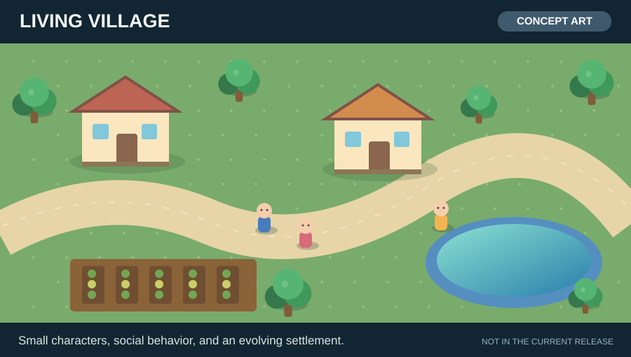
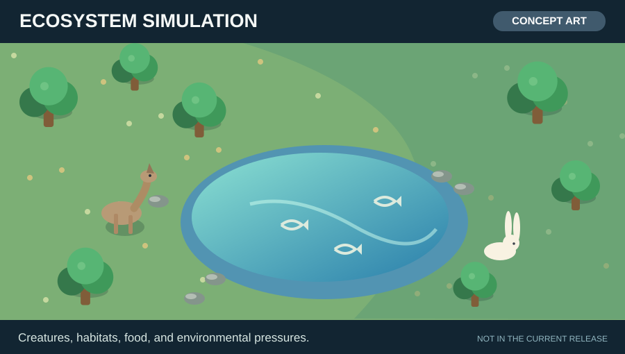
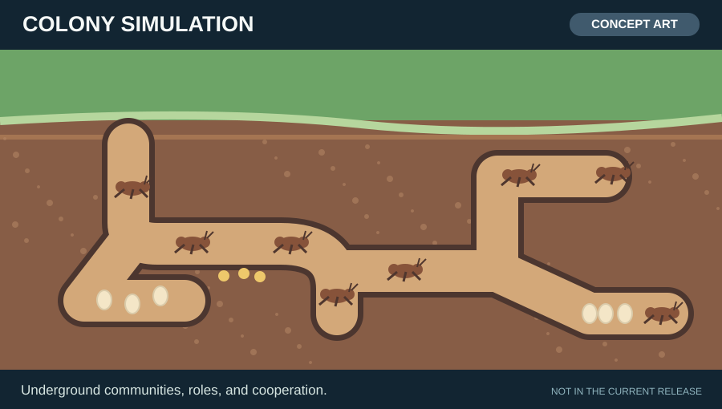
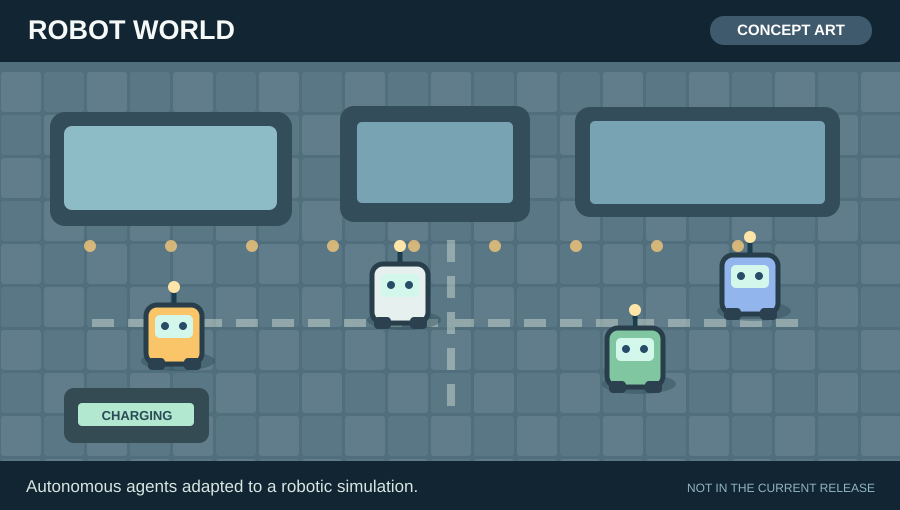

# Layer 1+ — Neural Artificial Life Sandbox

A small **experimental artificial-life simulation** with embodied neural agents in a browser-based world. Agents use hand-written neural networks to select actions, receive rewards, move around, interact, reproduce, and explore. An **optional local Ollama model** generates short agent narratives and ideas.

**Status:** This repository contains the original experimental **Layer 1 / 1+ source**, translated into English. It is released **as-is**. The author does **not** plan additional levels or ongoing feature development; community forks are welcome. Later layers in [the roadmap](docs/ROADMAP.md) are historical ideas, **not built features**.

This is **not evidence of artificial consciousness or validated self-recognition**, and is not a production-grade or peer-reviewed system. The modeled pleasure, affect, curiosity, and mirror-mark behavior are simulation constructs. See [Ethics](docs/ETHICS.md).

## A simple world. Many possible worlds.

The colored square agents are **intentionally simple visual markers**, not a limitation of the underlying simulation. The browser viewer (`public/`), world and agent logic (`src/world/`), and neural-learning implementation (`src/neural/`) are separate parts of the project. Developers can use this small experiment as a starting point for autonomous-character prototypes, simulations, or educational projects.

### Four possible directions — concept illustrations

**These illustrations are original concept art, not screenshots or implemented game features.** Each scenario would require additional graphics, behavior rules, and game-specific development.

| Living village | Ecosystem simulation |
|:---:|:---:|
|  |  |
| Small characters with individual needs, relationships, and activities. | Animals reacting to food, hazards, and environmental change. |

| Colony simulation | Robot world |
|:---:|:---:|
|  |  |
| Populations with new cooperation and role mechanics. | Agents with neural policies adapted to simulated robots. |

### Ideas for developers

- **Replace squares with sprites or animated characters.** Begin with the Canvas renderer in `public/viewer.js`. Graphical changes do not automatically require changes to neural-network logic.
- **Build a village or settlement.** Add buildings, resources, goals, schedules, social interactions, and reward rules appropriate to the new setting.
- **Create ecosystems or colonies.** Study competition, adaptation, and cooperation by changing sensors, actions, environmental constraints, and agent rewards.
- **Prototype robot behaviors.** Keep the basic neural-agent approach, but design new simulated sensors, movements, and tasks.
- **Make educational demonstrations.** Visualize learning, evolution-like inheritance, reward shaping, and emergent-looking behavior while retaining a clear distinction between simulation and scientific evidence.

**What the release is not:** a complete game engine, validated behavioral model, or production-ready framework. Features such as inventories, buildings, pathfinding, animations, save/load, and richer graphics must be implemented separately. The original author does not plan to develop further levels; independent forks and adaptations are welcome under the [MIT license](LICENSE).

## Quick start

**Hardware and temperature note:** Per-agent neural training can sustain substantial CPU load. An optional local Ollama model may add heavy processing when GPU acceleration is unavailable. On thermally constrained computers, lower the simulation workload, monitor temperatures, and stop if the system becomes excessively hot. You do not need Ollama to run the basic simulation.

**Requirements:** Node.js 20+ and npm. Optional: Ollama and a local compatible model for generated agent text.

From the repository directory:

```bash
npm ci
npm run typecheck
npm start
```

Open **http://localhost:8787** in your browser. `npm run dev` starts the TypeScript process in watch mode.

`npm ci` restores packages from `package-lock.json`. **`node_modules` is deliberately not included** in this source release. Internet access may be required for the initial npm dependency installation. The basic simulation does not require an external AI API or Ollama.

### Optional local language model

Install [Ollama](https://ollama.com/) and download a model that is actually available in your installation, for example:

```bash
ollama pull qwen3:4b-instruct
```

If Ollama is not already running, start its service according to your operating system (often `ollama serve`). In the browser sidebar, enter the Ollama host (`http://127.0.0.1:11434`), model name, enable the checkbox, and click **Save**. The prompt asks Ollama to respond in English (a particular model may not always comply). The local LLM is used only for language generation; the agent policy and reward-based training run separately. No Ollama account or cloud API key is needed.

If your model name differs, enter its installed identifier. The example tag above is not guaranteed to exist for every Ollama installation. Performance depends on hardware and model size.

## What's in Level 1+

- Small neural network per agent: 40 inputs, two hidden layers of 48 neurons, 11 actions, and policy/value heads.
- Hand-written `Float32Array` math, Adam optimizer, Advantage Actor-Critic-style updates, and generalized advantage estimation.
- Toroidal 2D simulation with food, hazard zones, mirrors, age, energy, integrity, and simulated affect.
- Reproduction with genome crossover and inheritance/mutation of learned neural weights.
- Curiosity-like novelty scores and generated exploration ideas.
- A reward-shaped **simulated mirror-mark task**; task completion is not evidence of consciousness or real animal-style mirror self-recognition.
- Canvas 2D viewer, agent details, brain-activity trace, events, and Ollama configuration.

Agents begin with random neural weights; outcomes, learning rates, and survival times are **not guaranteed**. There are no experimental controls, published replication data, or scientific performance claims included here.

## Project layout

```text
layer1-neural-world/
├── src/
│   ├── index.ts                 # Local HTTP/WebSocket server, loops, controls
│   ├── cognition/ollama.ts      # Optional local language generation
│   ├── neural/network.ts       # Neural network and learning code
│   └── world/                  # Agent, senses, world, action definitions
├── public/
│   ├── index.html               # Browser viewer
│   ├── viewer.js                # Browser rendering and controls
│   └── style.css
├── docs/                        # English architecture, ethics, ideas
├── tests/                       # Minimal release regression checks
├── package.json
├── package-lock.json
├── tsconfig.json
├── LICENSE
└── .gitignore
```

## Testing

```bash
npm run typecheck
npm test
```

The tests check basic neural/simulation contracts, English localization, and key configuration values; they are **not** a scientific benchmark. The Ollama-language-generation pathway needs a separately running Ollama model and is not covered by offline test assertions.

## Usage and security notes

- Intended for **local experimentation**, not public deployment. The original server does not provide authentication for administrative and control endpoints. Do not expose port `8787` to untrusted users or the Internet; use a restricted local environment. The Ollama host setting is configurable, so keep it limited to trusted local endpoints.
- Pause and Reset are available in the viewer. An in-memory maximum-runtime check is configured for 90 minutes by default.
- There is **no implemented persistent world save/load** in this release: restarting the server resets agents. The project is provided without maintenance guarantees.
- Agent utterances are generated text; do not interpret them as direct evidence of mental experiences.

## Read more

- [Architecture](docs/ARCHITECTURE.md)
- [Ethics](docs/ETHICS.md)
- [Original roadmap / future ideas](docs/ROADMAP.md)
- [Guide for independent contributors](docs/EXTENDING.md)
- [GitHub publishing guide](docs/PUBLISHING.md)
- [Validation results and limits](docs/VALIDATION.md)

## License

[MIT](LICENSE). Copyright © 2026 Janus Rokkjær. The dependency packages are installed separately through npm and retain their own licenses.
